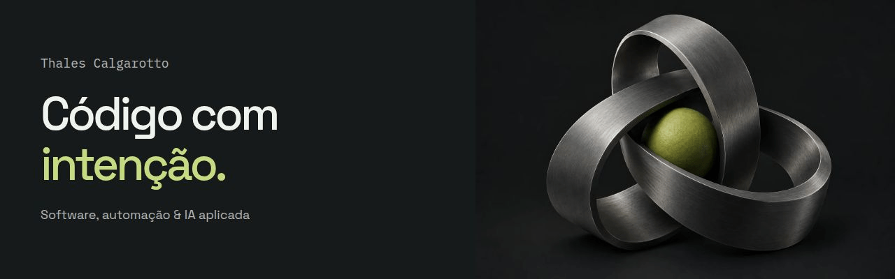

### Código com intenção.

Sou **Thales Calgarotto**. Construo produtos digitais, automatizo processos e conecto inteligência artificial a problemas reais.

Trabalho com **TypeScript, Python, aplicações web e mobile, recuperação de contexto e agentes de IA**. Os projetos abaixo mostram como essas peças se conectam.

**[Explore meu portfólio →](https://tcalgarotto.github.io/)** · [Projects, credentials & more in English](https://tcalgarotto.github.io/?lang=en)

 

### Projetos em destaque

**[JustOS / Lex](https://github.com/tcalgarotto/Lex)** 
Software jurídico que conecta casos, documentos e pesquisa assistida por IA, com revisão humana no fluxo. 
`Next.js` `TypeScript` `PostgreSQL` `Qdrant`

**[Lucy / loop-master](https://github.com/tcalgarotto/loop-master)** 
Orquestração de agentes no Cursor: planejamento por fases, memória entre sessões e ciclos de implementação e verificação. 
`Agent workflows` `Cursor` `MCP`

**[TeleMed](https://github.com/tcalgarotto/telemed)** 
Plataforma de telemedicina por assinatura com aplicativo mobile e API em um monorepo TypeScript. 
`React Native` `Expo` `Next.js` `Supabase`

 

### Formação com credenciais verificáveis

| Formação | Instituição | Conclusão | Credencial |
| :--- | :--- | :--- | :--- |
| IBM RAG and Agentic AI | IBM | 26 ago 2026 | [Verificar](https://www.coursera.org/account/accomplishments/specialization/TBLJ0PQF1DGQ) |
| Google IT Automation with Python | Google | 22 jul 2026 | [Verificar](https://www.coursera.org/account/accomplishments/specialization/O7S722GGTAOK) |
| Social Computing | Johns Hopkins University | 22 jul 2026 | [Verificar](https://www.coursera.org/account/accomplishments/specialization/ZEYD9IMM47R9) |

Formações concluídas no **Coursera**, em meu nome. IBM e Johns Hopkins são especializações; Google IT Automation with Python é um certificado profissional.

 

### Como as peças se conectam

- **Produto:** interfaces web e mobile conectadas a APIs e dados.
- **IA aplicada:** pesquisa com contexto, agentes e integração de ferramentas.
- **Automação:** Python, Git e processos que reduzem trabalho repetitivo.

 

**[Conheça os projetos, explore a arquitetura e confira as certificações no portfólio →](https://tcalgarotto.github.io/)**
