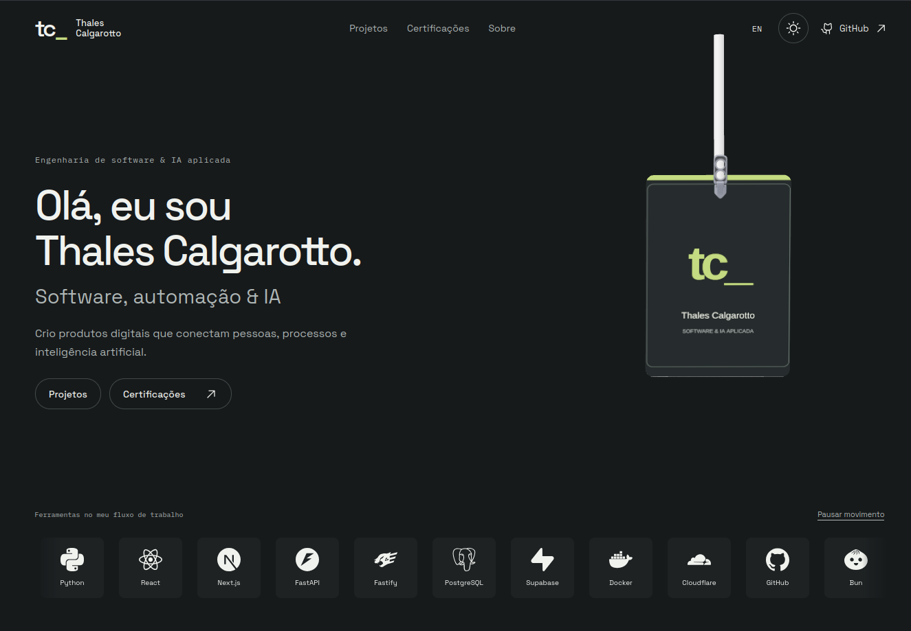
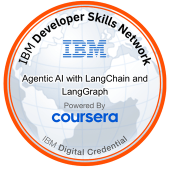
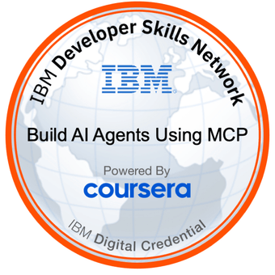
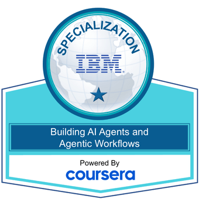
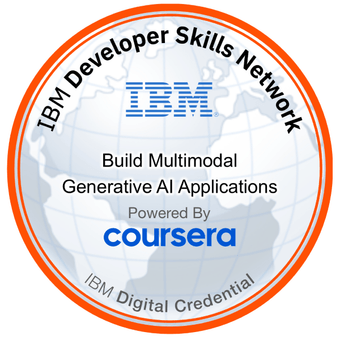
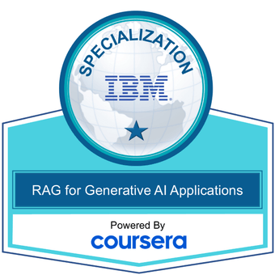
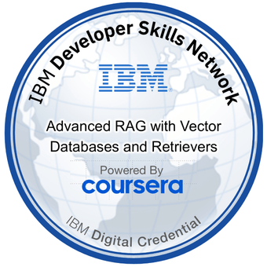

### Curiosidade para começar. Persistência para entregar.

Sou **Thales Calgarotto**. Gosto de entender como as coisas funcionam — e de construir coisas que funcionem para alguém.

Meu trabalho conecta **desenvolvimento de produtos, automação e inteligência artificial aplicada**. Da primeira ideia aos detalhes da experiência, procuro fazer as peças se encaixarem: interface, lógica, dados e o problema que motivou tudo isso.

Aprender, construir, testar e refinar fazem parte do mesmo trabalho.

 

### Projetos que dão forma a esse trabalho

#### [DuckDooh ↗](https://duckdooh.com/)

**Mídia exterior digital, com uma experiência de compra pela web.**

Uma plataforma para descobrir telas, escolher onde anunciar e organizar campanhas. O projeto conecta uma experiência digital ao mundo físico: a marca sai da tela do computador e chega aos pontos de exibição.

**Como foi feito:** interface em Next.js e TypeScript, API em Python/FastAPI e dados em PostgreSQL. Asaas e Yodeck conectam contratação, pagamento e veiculação.

**[Acesse e teste o DuckDooh →](https://duckdooh.com/)**

 

#### [OrtoClean ↗](https://ortoclean.duckdns.org/login-teste)

**Gestão da clínica em um só lugar.**

Pacientes, agenda, financeiro e indicadores reunidos em uma experiência web. Um projeto voltado à rotina da clínica, com organização das informações e acesso por perfil.

**Como foi feito:** API em Fastify e TypeScript, persistência em PostgreSQL e implantação com Docker. Módulos por clínica e integração do CRM com um serviço de WhatsApp separado.

**[Acesse e teste o OrtoClean →](https://ortoclean.duckdns.org/login-teste)**

 

### O cuidado por trás da entrega

- **Entender antes de implementar.** Investigar o problema e o contexto de quem vai usar.
- **Construir e verificar.** Testar caminhos, revisar decisões e cuidar dos detalhes.
- **Continuar evoluindo.** Aprender com o uso e voltar ao que pode ficar mais claro, simples e confiável.

Trabalho com **TypeScript, Python, aplicações web, APIs, dados, automação e agentes de IA**. Escolho as ferramentas a partir do que o projeto pede.

 

### Certificações

<table>
<tr>
<td align="center" width="25%"><a href="https://www.coursera.org/account/accomplishments/specialization/TBLJ0PQF1DGQ" title="IBM RAG and Agentic AI"> IBM RAG &amp; Agentic AI</a></td>
<td align="center" width="25%"><a href="https://www.coursera.org/account/accomplishments/specialization/O7S722GGTAOK" title="Google IT Automation with Python"> Google IT Automation with Python</a></td>
<td align="center" width="25%"><a href="https://www.credly.com/badges/2517e0cd-b82a-4d91-a8ce-118a3ab8d623" title="Agentic AI with LangChain and LangGraph"> Agentic AI with LangChain &amp; LangGraph</a></td>
<td align="center" width="25%"><a href="https://www.credly.com/badges/00885239-67e9-44b8-8aea-a4762a51d0a8" title="Build AI Agents Using MCP"> Build AI Agents Using MCP</a></td>
</tr>
<tr>
<td align="center" width="25%"><a href="https://www.credly.com/badges/b7f819d9-feb2-4109-aee9-38e73e832e21" title="Building AI Agents and Agentic Workflows Specialization"> Building AI Agents &amp; Agentic Workflows</a></td>
<td align="center" width="25%"><a href="https://www.credly.com/badges/5c376cfb-5b16-4902-85e7-1d450603060d" title="Build Multimodal Generative AI Applications"> Build Multimodal Generative AI Applications</a></td>
<td align="center" width="25%"><a href="https://www.credly.com/badges/a544a088-6bc7-4713-b3fb-a6b8244dbda2" title="RAG for Generative AI Applications Specialization"> RAG for Generative AI Applications</a></td>
<td align="center" width="25%"><a href="https://www.credly.com/badges/afbbb50d-3af3-4f1a-b9a6-2970b3e1bca9" title="Advanced RAG with Vector Databases and Retrievers"> Advanced RAG with Vector Databases &amp; Retrievers</a></td>
</tr>
</table>

**Código com intenção. Cuidado em cada etapa.**

**[Explore meu portfólio →](https://tcalgarotto.github.io/)** · [Projects & credentials in English](https://tcalgarotto.github.io/?lang=en)
