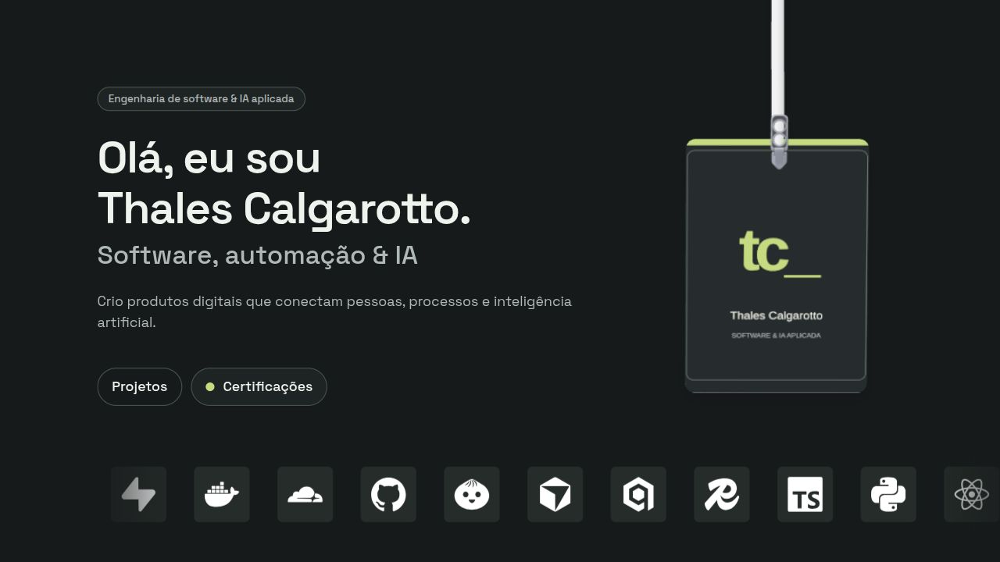
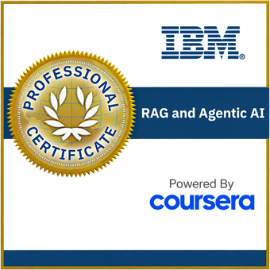
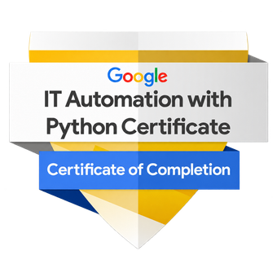
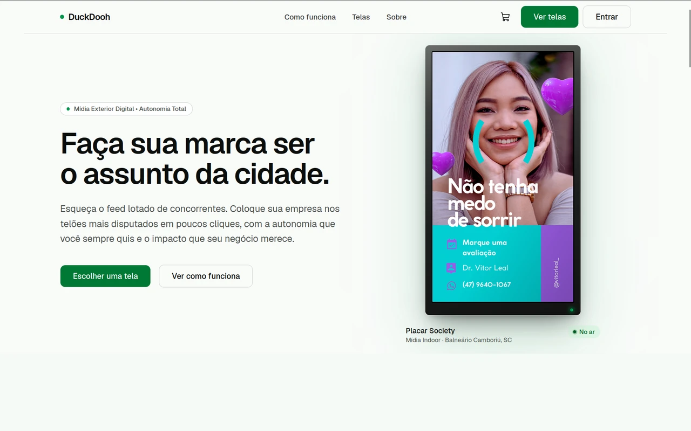
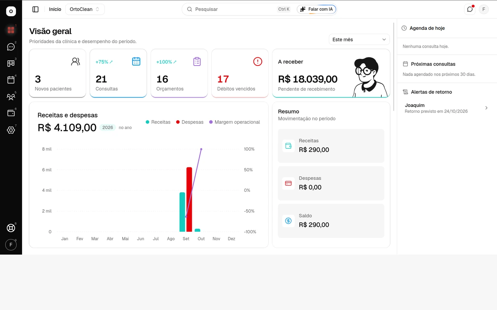

<a href="https://tcalgarotto.github.io/">
  <picture>
    <source media="(prefers-color-scheme: light)" srcset="assets/profile-hero-44-light.png" />
    
  </picture>
</a>

### Credenciais em destaque

  
  

[IBM RAG e Agentic AI](https://www.coursera.org/account/accomplishments/specialization/TBLJ0PQF1DGQ) · [Google IT Automation with Python](https://www.coursera.org/account/accomplishments/specialization/O7S722GGTAOK)

### Curiosidade para começar. Persistência para entregar.

Sou **Thales Calgarotto**. Gosto de entender como as coisas funcionam — e de construir coisas que funcionem para alguém.

Meu trabalho conecta **desenvolvimento de produtos, automação e inteligência artificial aplicada**. Da primeira ideia aos detalhes da experiência, procuro fazer as peças se encaixarem: interface, lógica, dados e o problema que motivou tudo isso.

Aprender, construir, testar e refinar fazem parte do mesmo trabalho.

 

### Projetos que dão forma a esse trabalho

#### [DuckDooh ↗](https://duckdooh.com/)

**Mídia exterior digital, com uma experiência de compra pela web.**

Uma plataforma para descobrir telas, escolher onde anunciar e organizar campanhas. O projeto conecta uma experiência digital ao mundo físico: a marca sai da tela do computador e chega aos pontos de exibição.

**Como foi feito:** interface em Next.js e TypeScript, API em Python/FastAPI e dados em PostgreSQL. Asaas e Yodeck conectam contratação, pagamento e veiculação.

**[Acesse e teste o DuckDooh →](https://duckdooh.com/)**

 

#### [OrtoClean ↗](https://ortoclean.duckdns.org/login-teste)

**Gestão da clínica em um só lugar.**

Pacientes, agenda, financeiro e indicadores reunidos em uma experiência web. Um projeto voltado à rotina da clínica, com organização das informações e acesso por perfil.

**Como foi feito:** API em Fastify e TypeScript, persistência em PostgreSQL e implantação com Docker. Módulos por clínica e integração do CRM com um serviço de WhatsApp separado.

**[Acesse e teste o OrtoClean →](https://ortoclean.duckdns.org/login-teste)**

 

### O cuidado por trás da entrega

- **Entender antes de implementar.** Investigar o problema e o contexto de quem vai usar.
- **Construir e verificar.** Testar caminhos, revisar decisões e cuidar dos detalhes.
- **Continuar evoluindo.** Aprender com o uso e voltar ao que pode ficar mais claro, simples e confiável.

Trabalho com **TypeScript, Python, aplicações web, APIs, dados, automação e agentes de IA**. Escolho as ferramentas a partir do que o projeto pede.

 

### Aprendizado que vira prática

Continuo estudando e trazendo esse aprendizado para os projetos.

<strong>Formação e credenciais</strong>

 

- **IBM — RAG and Agentic AI** · Especialização · 26 ago 2026 · [Credencial](https://www.coursera.org/account/accomplishments/specialization/TBLJ0PQF1DGQ)
- **Google — IT Automation with Python** · Certificado profissional · 22 jul 2026 · [Credencial](https://www.coursera.org/account/accomplishments/specialization/O7S722GGTAOK)

Formações concluídas pelo Coursera.

 

**Código com intenção. Cuidado em cada etapa.**

**[Explore meu portfólio →](https://tcalgarotto.github.io/)** · [Projects & credentials in English](https://tcalgarotto.github.io/?lang=en)
